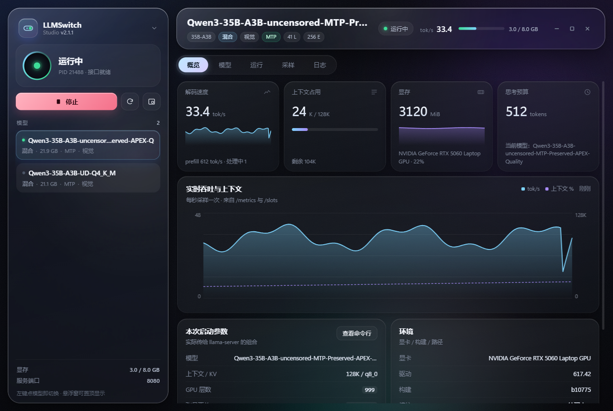
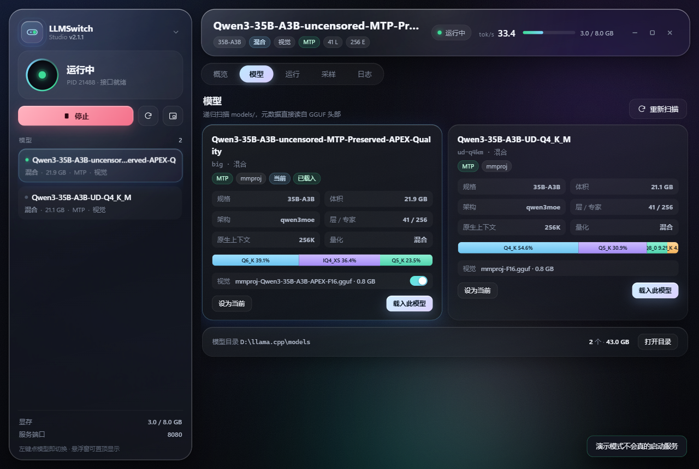
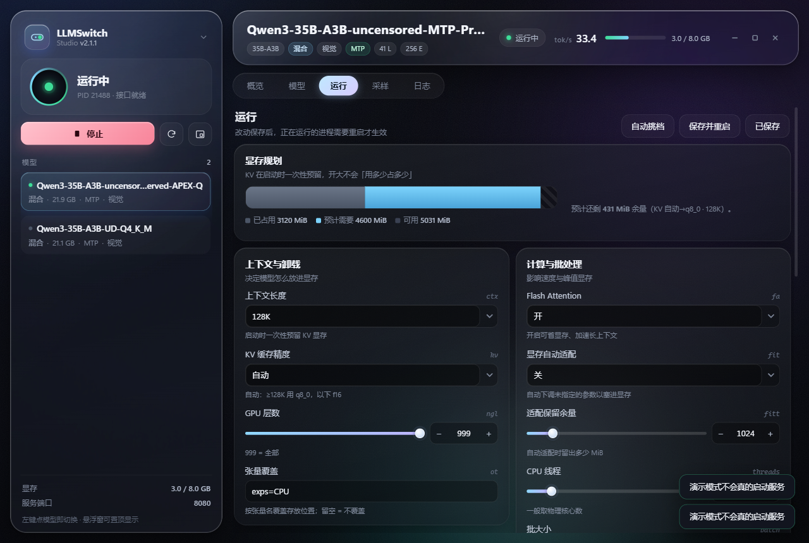
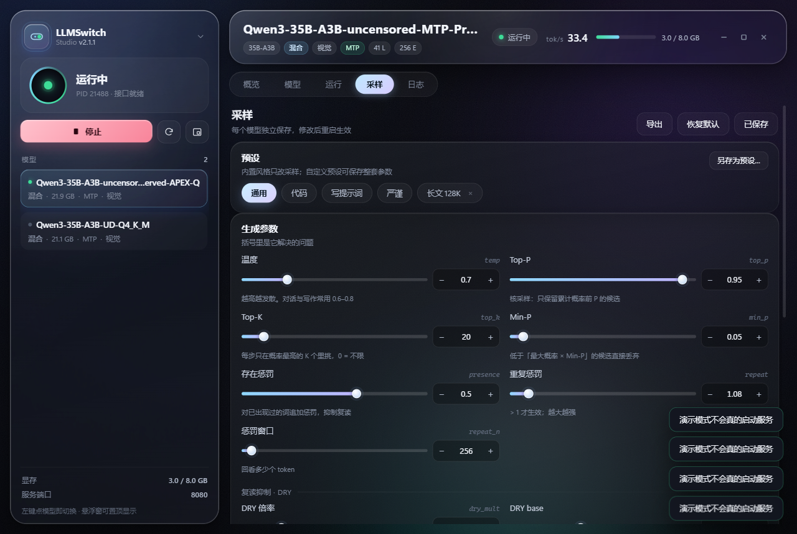
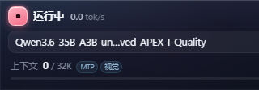

# LLMSwitch Studio

A desktop console for [llama.cpp](https://github.com/ggml-org/llama.cpp) — switch models,
plan VRAM, tune every launch flag, and watch live throughput, in a liquid-glass UI.



<sub>English · [简体中文](README.zh-CN.md)</sub>

---

## Why another front-end?

`llama-server` is excellent, but its useful surface is scattered across CLI flags, log files and
HTTP endpoints. LLMSwitch Studio puts the three things you actually do all day in one window:

| You want to… | What the app gives you |
|---|---|
| **see** what is loaded | model metadata read straight from the GGUF header (arch, layers, experts, native ctx, quant) |
| **change** it safely | VRAM planner that compares the estimated footprint with what is actually free, then suggests a context size |
| **know** how it is doing | decode/prefill tok/s, context usage from `/slots`, request count and speculative-accept rate from `/metrics`, plus a 3-minute history |

Everything is local. No telemetry, no account, no cloud.

## Features

- **Model library** — recursive scan of `models/`, real GGUF metadata, one-click load.
  Quantisation is computed from **tensor byte shares** (most GGUFs are mixed, e.g. `Q6_K 39% · IQ4_XS 36% · Q5_K 23%`),
  not from the `general.file_type` tag, which only says "MOSTLY_…". Models are named after their file, and the
  vision projector (`mmproj`) is listed with a switch to enable/disable it per model.
- **Load / swap / restart** — one state machine (`stopped → starting → running → stopping`) plus an
  automatic warm-up request, so the first real prompt is not the one paying for graph allocation.
- **VRAM & CUDA panel** — `-ngl`, `-ot`, `-fa`, `-fit`, `-t`, `-b`, `-ub`, `--cache-ram`, `--keep`,
  `--no-kv-offload`, `--moe-cache-mib`, speculative decoding, KV cache type — all editable, with a
  live budget bar (used / needed / free).
- **Sampling panel** — 18 parameters with sliders + steppers, four built-in styles
  (general / code / prompt-writing / strict), and **your own presets** (save a whole parameter set under a name).
- **Floating HUD** — a 320×112 always-on-top mini window: status, tok/s, VRAM, a context bar, and a
  click-to-switch model list. Start/stop is the small round button; expand and close are icons, so
  the window stays out of the way.
- **Logs** — tail of `llama-server` output with error highlighting.
- **Export** — copy the exact command line that was used, or export JSON / `.bat` / `.sh`.
- **Local API** — every action is a JSON call on `127.0.0.1` with a random per-session token.

| Models | Runtime |
|---|---|
|  |  |

| Sampling | Floating window |
|---|---|
|  |  |

## Requirements

- **Windows 10 / 11 (x64)**
- **Microsoft Edge WebView2 Runtime** — bundled with Windows 11 and most updated Windows 10
  machines. If it is missing, install the
  [Evergreen Runtime](https://developer.microsoft.com/microsoft-edge/webview2/); without it the app
  falls back to an Edge `--app` window, which adds a ~29 px browser strip above the page.
  Chromium is required for the refraction in `backdrop-filter`.
- **A llama.cpp build with `llama-server.exe`**, with your models under `models/` next to it.
- Python 3.8+ **only if you run from source** (the prebuilt release bundles its own interpreter).

> Linux / macOS are not supported yet: window handling and GPU detection are Win32-specific.

## Quick start (prebuilt)

1. Download **`LLMSwitchStudio.exe`** from **Releases** — a single file, no unzip, no installer.
   Put it anywhere you like.
2. Double-click it. The first launch unpacks into a temp folder, so it takes a few seconds longer
   than later ones.
3. If no models show up, a banner asks for the folder containing `llama-server.exe` —
   paste the path and press **Save**.

The app looks for `llama-server.exe` in the current folder and up to five parent folders, so keeping
the exe *inside* your llama.cpp directory (or right next to it) makes it work with zero setup.
You can also set the environment variable `LLAMA_SWITCH_DIR`.

Windows SmartScreen may warn about an unsigned app: **More info → Run anyway**, or verify the
SHA-256 published with the release.

## Run from source

```
python app.py                 # normal window
python app.py --mini          # floating HUD only
python app.py --serve         # backend only, no window
python app.py --browser       # default browser instead of a native window
python app.py --llama-dir D:\llama.cpp --port 8770 --llama-port 8080
```

The frameless native window uses [pywebview](https://pywebview.flowrl.com/) + WebView2
(`pip install pywebview`); without it the app opens an Edge `--app` window instead.
`run.bat` / `run-mini.bat` are thin wrappers that find a usable Python (each candidate is actually
executed and asked for its version — `where py` alone is not trusted) and prefer an interpreter
that has `pywebview` installed.

## Build the executable

```
pip install pyinstaller pywebview
python build_exe.py                  # single file   -> dist/LLMSwitchStudio.exe
python build_exe.py --onedir         # folder build  -> dist/LLMSwitchStudio/
python build_exe.py --out D:\apps    # custom output directory
```

The single-file build bundles Python, pywebview, pythonnet and the WebView2 interop DLLs
(~12 MB). The build runs PyInstaller in a temp directory and copies the result back, because some
antivirus setups corrupt executables written directly into certain folders. If a produced exe exits
instantly with `Could not load PyInstaller's embedded PKG archive`, build into another folder (or run
from source).

## How it works

```
┌──────────────────────────────┐         ┌────────────────────────────────────┐
│  UI (web/, no framework)     │  HTTP   │  Python backend (core/, stdlib)    │
│  · liquid glass via          │◄───────►│  api.py      JSON API + static     │
│    backdrop-filter + SVG     │  1 s    │  server.py   process + command line│
│  · canvas charts, controls   │  poll   │  monitor.py  /health /props        │
└──────────────────────────────┘  token  │              /slots /metrics       │
┌──────────────────────────────┐         │  gguf.py     GGUF header parser    │
│  WebView2 window (pywebview) │◄────────┤  config.py   schema / presets      │
│  · frameless, topmost HUD    │         └────────────────────────────────────┘
│  · Edge --app fallback       │
└──────────────────────────────┘
```

Two ports, deliberately:

| Port | Who | Why |
|---|---|---|
| `8080` (configurable) | `llama-server` | the port your OpenAI-compatible client talks to |
| `8770` (configurable) | this app's console API | serves the UI, receives commands |

They must not be the same: on Windows `SO_REUSEADDR` lets two processes bind one port, and
`llama-server` will silently steal the console port, leaving the UI stuck on "starting".

## Configuration & data

All state lives next to the executable (portable), or in `%LOCALAPPDATA%\LLMSwitch` if that folder
is read-only:

```
LLMSwitchData/
  state.json        # per-model parameters, presets, window position
  app.log           # what the app did
  llama-server.log  # llama.cpp output
  edge-profile/     # isolated Edge profile (fallback host only)
```

`state.json` is plain JSON — back it up or copy it between machines.
Upgrading from v2.1.0 or older? The first run copies `state.json` from the old
`.workbuddy/` folder automatically; the old folder is left untouched.

## HTTP API

Bound to `127.0.0.1` only; every `/api/*` call needs the token from `LLMSwitchData/runtime.json`
(`X-Token` header or `?t=`).

| Method | Path | Purpose |
|---|---|---|
| GET | `/api/snapshot` | everything: status, models, config, live metrics, history |
| GET | `/api/logs?n=400` | log tail |
| GET | `/api/export?format=bat\|json\|sh` | export the equivalent launch command / config |
| POST | `/api/server` | `{"action":"start\|stop\|restart\|swap","model":"<id>"}` |
| POST | `/api/select` | `{"id":"<model id>"}` |
| POST | `/api/config` | `{"id":"…","cfg":{"launch":{…},"sampling":{…}}}` |
| POST | `/api/style` | `{"style":"gen\|code\|prompt\|strict"}` |
| POST | `/api/presets` | `{"action":"save\|delete\|get","name":"…","cfg":{…}}` |
| POST | `/api/window` | `{"mini":true,"topmost":true}` — open the floating HUD |
| POST | `/api/settings` | `{"llama_dir":"D:\\llama.cpp"}` |

A model id is the path relative to the llama.cpp folder, e.g.
`models\my-model\Qwen3-35B-A3B-Q4_K_M.gguf`.

## Troubleshooting

**"启动失败" with a reason.** The dashboard shows a short cause (out of memory / bad flag /
model not found / port in use / permission / CUDA error); the **Logs** tab has the raw line.
When the process exits immediately, the reason is taken from the end of `llama-server.log`, because
`Popen` itself succeeds in that case.

**Out of memory.** KV cache is reserved **at startup**, not on demand. Lower the context size, switch
KV to `q8_0`, or close other GPU consumers (browsers and image tools keep VRAM even after their
windows are closed). The budget bar turns amber before you hit the wall.

**Port already in use.** Start with `--port` / `--llama-port`, keeping them different from each other.

**No window appears.** The app first tries pywebview + WebView2, then Edge `--app`, then your
default browser (see `app.log`). `--browser` forces the last path. If no native window ever shows
up, install the WebView2 Runtime and make sure `msedge.exe` exists.

**The window has a browser strip on top.** That is the Edge `--app` fallback, which cannot remove
Chromium's own title bar. Installing WebView2 gives the true frameless window; `--framed` restores a
native title bar on purpose.

**The floating HUD is the wrong size or off-screen.** It is 320×112 logical pixels (`--mini`).
At 150 % scaling that is 480×168 physical pixels. If a multi-monitor setup places it off-screen,
reopen it — the position is clamped to the current work area.

**Antivirus complains.** The release is an unsigned PyInstaller build, which some engines flag heuristically.
Verify it against the release hash, whitelist the folder, or run from source. The app never phones home; the only
network activity is `127.0.0.1`.

**The exe does nothing when double-clicked.** Usually an antivirus sandbox or a protected folder.
Move the folder somewhere else (for example next to `llama-server.exe`), check `crash.log` beside the
exe, or run from source. `build_exe.py` documents the same workaround.

**AMD / Intel GPU.** VRAM numbers come from `nvidia-smi`; without it the dashboard shows "未检测到"
and the planner falls back to its formula. The server still starts normally.

**Chinese UI.** The interface is Chinese today; user-facing strings live in `core/config.py`
(parameter labels and hints) and `web/js/app.js`. i18n pull requests are welcome.

## License

[MIT](LICENSE).

## Credits

- [llama.cpp](https://github.com/ggml-org/llama.cpp) — server, endpoints and every flag documented in
  `tools/server/README.md`.
- Apple, *Meet Liquid Glass* (WWDC25) — the material / lensing / specular model this UI follows.
- [1ar labs, *How Liquid Glass works*](https://1arlabs.com/updates/how-liquid-glass-works) — displacement
  maps and 2D refraction.
- [webtricks.dev, *Liquid glass in CSS*](https://webtricks.dev/blog/liquid-glass-css) and
  [sohumsuthar/liquid-glass](https://github.com/sohumsuthar/liquid-glass) — the `feDisplacementMap`
  filter graph, RGB displacement encoding, `color-interpolation-filters="sRGB"`, and the
  "keep refraction on hero surfaces only" performance rule.
- [LogRocket, *How to create Liquid Glass effects with CSS and SVG*](https://blog.logrocket.com/how-create-liquid-glass-effects-css-and-svg) —
  specular rim compositing.
